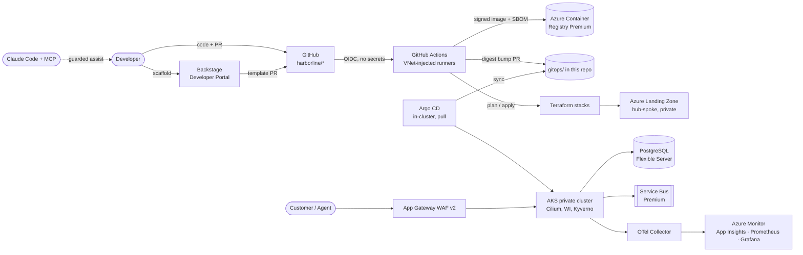

# Harborline Internal Developer Platform (IDP)

> The paved road for building, shipping and running services at Harborline Insurance on Azure.

This repository is the single source of truth for the Harborline platform: infrastructure (Terraform), cluster
configuration (GitOps with Argo CD), security guardrails (Azure Policy + Kyverno), delivery pipelines (GitHub Actions),
the developer portal (Backstage), observability (OpenTelemetry + Azure Monitor), AI-assisted development guardrails
(Claude + MCP) and a reference 3-tier insurance application that walks the golden path end to end.

> **Harborline Insurance is a fictional company.** All identifiers (tenant IDs, subscription IDs, domains such as
> `harborline.example`) are placeholders you replace during onboarding — see [First-run checklist](#first-run-checklist).

---

## Architecture at a glance



Full diagrams: [docs/architecture/overview.md](docs/architecture/overview.md).

## Repository map

| Path | What lives here | Owner |
|---|---|---|
| `infra/terraform/modules/` | Reusable, opinionated Terraform modules (AKS, network, PostgreSQL, Service Bus, …) | Platform Engineering |
| `infra/terraform/stacks/` | Deployable root modules with per-environment `tfvars` and backend config | Platform Engineering |
| `platform/charts/golden-service/` | The one Helm chart every service uses (secure-by-default) | Platform Engineering |
| `platform/policies/` | Kyverno cluster policies + tests, Conftest/OPA rules for Terraform plans | Security Architecture |
| `platform/observability/` | Grafana dashboards, alert rules, OTel conventions | SRE |
| `gitops/` | Argo CD bootstrap, AppProjects, ApplicationSets, add-ons, tenants, workload values | Platform + tenant teams |
| `apps/insurance/` | Reference 3-tier app: React web, FastAPI policy API, claims worker, SQL migrations | Insurance Digital team |
| `backstage/` | Developer portal app, catalog, software templates | Platform Product |
| `ai/` | Platform MCP server and AI tooling | Platform Engineering |
| `.claude/` | Claude Code guardrails: permissions, hooks, slash commands, sub-agents | Security Architecture |
| `.github/workflows/` | CI/CD: Terraform, secure container build, promotion, policy tests, docs, AI review | DevSecOps |
| `docs/` | Architecture, ADRs, security, governance, operations, runbooks (published via TechDocs) | Everyone |
| `scripts/` | Bootstrap and validation helpers | Platform Engineering |

## Golden path in five steps

1. **Scaffold** — Backstage → *Create* → “Python API service”. You get a repo with CI, Dockerfile, catalog entry,
   TechDocs, OpenTelemetry, health probes and a GitOps values file.
2. **Onboard your team** — Backstage → “Tenant onboarding” opens a PR here adding a namespace, quotas, network policy,
   RBAC bound to your Entra group and an Argo CD AppProject.
3. **Ship** — merge to `main`. The pipeline tests, scans (CodeQL, Trivy, Gitleaks), builds, generates an SBOM, signs
   with Sigstore keyless and attests provenance, then bumps the image digest in `gitops/workloads/dev/...`.
4. **Run** — Argo CD syncs dev. Kyverno verifies the signature, PSS-restricted policy and labels before admission.
   Telemetry flows to Azure Monitor; your service appears in Grafana and Backstage automatically.
5. **Promote** — run *Promote* (`dev → stg → prod`). It opens a PR copying the exact digest; prod requires CAB-free
   approval from code owners because policy, tests and evidence travel with the change.

Details: [docs/governance/golden-path.md](docs/governance/golden-path.md).

## Quick start

```bash
make help              # list all targets
make validate          # fmt + lint + policy tests + unit tests (no Azure access needed)
make docs-serve        # TechDocs-compatible docs at http://127.0.0.1:8000
make app-up            # run the insurance app locally (Postgres + Service Bus emulator)
```

Deploying to Azure: [docs/deployment-guide.md](docs/deployment-guide.md).

## Standards this platform implements

| Framework | Where it is implemented | Evidence |
|---|---|---|
| Azure Landing Zone (CAF) | Hub-spoke, management group placement, policy-driven governance | [landing-zone.md](docs/architecture/landing-zone.md) |
| Microsoft Well-Architected Framework | Pillar-by-pillar design decisions | [well-architected.md](docs/architecture/well-architected.md) |
| NIST CSF 2.0 | Control matrix GV/ID/PR/DE/RS/RC → repo artifacts | [controls-matrix.md](docs/security/controls-matrix.md) |
| CIS AKS Benchmark | Recommendation-level mapping with enforcement point | [cis-aks-benchmark.md](docs/security/cis-aks-benchmark.md) |
| OWASP ASVS 5.0 (L2) | Chapter mapping for the reference app and service template | [owasp-asvs.md](docs/security/owasp-asvs.md) |
| SLSA / Sigstore | Signed images, provenance attestations, admission verification | [supply-chain-security.md](docs/security/supply-chain-security.md) |
| Platform engineering (CNCF) | Platform-as-product, golden paths, self-service, scorecards | [product/charter.md](docs/product/charter.md) |

## First-run checklist

Before the first `terraform apply` in a real tenant:

- [ ] Replace placeholders: `00000000-0000-0000-0000-000000000000` (tenant/subscription/group IDs), `harborline`
      (GitHub org), `harborline.example` (DNS). `grep -rn "00000000-0000" .` lists them.
- [ ] Run `scripts/bootstrap-state.sh` once per subscription to create the Terraform state account.
- [ ] Create GitHub environments `dev`, `stg`, `prod` with required reviewers on `stg`/`prod`.
- [ ] Pin every GitHub Action to a full commit SHA: `make pin-actions` (uses `pinact`). Tags are shipped for
      readability; the governance standard requires SHAs.
- [ ] Generate lock files: `make lock` (Python `uv.lock`, Node `package-lock.json`, Terraform `.terraform.lock.hcl`).
- [ ] Confirm the AKS version in `env/*.tfvars` with `az aks get-versions -l canadacentral`.
- [ ] Review ADRs in `docs/adr/` — they record decisions you may want to revisit for your organization.

## Contributing

Read [CONTRIBUTING.md](CONTRIBUTING.md). Every change goes through a PR with code-owner review; AI-assisted changes
follow [docs/ai/usage-policy.md](docs/ai/usage-policy.md). Security issues: [SECURITY.md](SECURITY.md).
