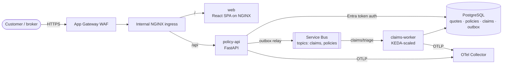

# Harborline Policy Portal (reference 3-tier application)

A realistic insurance workload that walks the golden path end to end. Synthetic data only.



| Tier | Component | Highlights |
|---|---|---|
| Presentation | `web/` | MSAL (auth code + PKCE), strict CSP, runtime config, read-only rootfs |
| Application | `policy-api/` | Entra JWT validation, scope/role authZ, pydantic strict models, RFC 9457 errors, transactional outbox |
| Async processing | `claims-worker/` | CloudEvents, idempotent inbox, poison → DLQ, transient → retry, trace propagation |
| Data | PostgreSQL Flexible Server | Entra-only auth, least-privilege roles per identity, migrations as Argo CD PreSync hook |

## Business flows

1. **Quote** — `POST /api/v1/quotes` rates auto/home risks (`rating.py`), returning quoted/referred/declined.
2. **Bind** — `POST /api/v1/policies` binds a quote; the `policy.bound` event is written to the outbox in the same
   transaction and relayed to the `policies` topic.
3. **FNOL** — `POST /api/v1/claims` records the claim and emits `claim.submitted` (no PII in the event).
4. **Triage** — `claims-worker` scores the claim (`triage.py`) and routes it to fast-track, adjuster or SIU.

## Run locally

```bash
make app-up      # postgres + Service Bus emulator + api + worker + web
open http://localhost:8081
make app-test    # unit tests (no containers needed)
```

## Deploy

Merging to `main` builds, scans, signs and deploys to dev via `gitops/workloads/dev/insurance/*`. Promote with the
*Promote* workflow. Infrastructure lives in `infra/terraform/stacks/workload-insurance`.

Security analysis: `docs/security/threat-model-insurance-app.md`.
