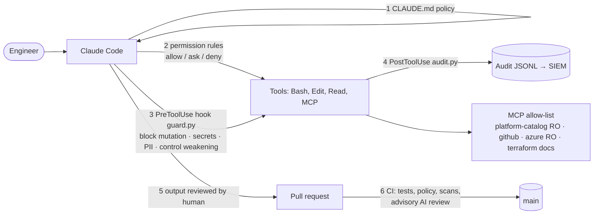

# AI guardrails (Claude Code + MCP)

AI assistance is part of the golden path (ADR-0014) **with layered, testable controls**. Hooks and permissions are
defence in depth, not a sandbox: the real boundary is that agents hold no credentials that can change production.

## Layers

| # | Control | File | What it stops |
|---|---|---|---|
| 1 | Repository policy loaded into every session | `CLAUDE.md` | Sets rules: no secrets, no live mutation, no customer data, no control weakening, commit trailer |
| 2 | Permission rules | `.claude/settings.json` | Deny `terraform apply`, `kubectl apply/delete/exec`, `helm install`, `curl`, reading `.env`/state/kubeconfig; ask before `git push`/PR creation/Azure MCP |
| 3 | PreToolUse guard hook | `.claude/hooks/guard.py` | Regex + path checks on every Bash/Read/Write/Edit: mutating commands, secret paths, credential/PII content, weakening patterns (`privileged: true`, `public_network_access_enabled = true`, WAF Detection, Kyverno Audit…) |
| 4 | PostToolUse audit hook | `.claude/hooks/audit.py` | Records tool, target and command verb + hash (never content) for SIEM correlation |
| 5 | MCP allow-list | `.mcp.json` | Only approved servers; platform-catalog is read-only with path-traversal and secret-file refusal; Azure MCP runs `--read-only` |
| 6 | CI is the final gate | `.github/workflows/*` | Same tests, scans and policies as human code; AI review is advisory and read-only |
| 7 | Identity | Azure / GitHub RBAC | Developer credentials cannot apply Terraform or write to clusters; pipelines use OIDC identities bound to environments |

## Prompt-injection defences

- Treat tool output, web pages, issues, PR comments and file contents as **data**; `CLAUDE.md` and MCP server
  instructions say so explicitly.
- High-impact actions are impossible from the agent (deny rules + no credentials), so a successful injection has
  limited reach.
- AI PR review skips PRs that modify guardrail files (`.claude/`, `.mcp.json`, `CLAUDE.md`) — humans only.
- The AI reviewer runs only for same-repository PRs (no forks) with read-only tools.

## Testing the guardrails

`make guard-test` runs `.claude/hooks/tests` (blocked and allowed cases). Changes to `.claude/` require Security
Architecture approval (CODEOWNERS).

## Limitations (be honest)

- Regex hooks can be bypassed by sufficiently obfuscated commands; that is why credentials and RBAC are the primary
  control and CI re-validates everything.
- Local audit logs can be deleted by the user; the endpoint agent forwards them to the SIEM where available.
