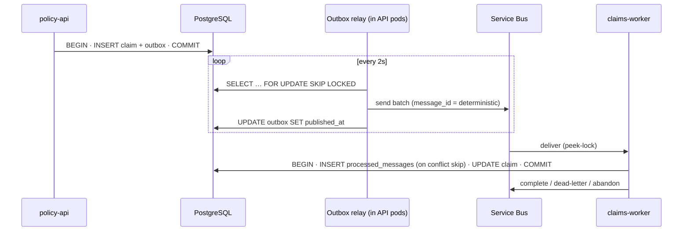

# Data and messaging

## PostgreSQL Flexible Server (ADR-0007)

| Setting | dev | stg | prod |
|---|---|---|---|
| SKU | B_Standard_B2ms | GP_Standard_D2ds_v5 | GP_Standard_D4ds_v5 |
| HA | — | Zone-redundant | Zone-redundant (zone 1 ↔ 2) |
| Backups | 7 days | 7 days | 35 days, geo-redundant (Canada East) |
| Network | Private endpoint only | Private endpoint only | Private endpoint only |
| Auth | Entra only | Entra only | Entra only |

**Access model.** Each application identity maps to a PostgreSQL role created by the migration job with
`pgaadauth_create_principal`, and receives only the grants it needs (`policy_api.migrate.GRANTS`). Nobody holds a
password. DBAs elevate through PIM into the Entra admin group for break-glass.

**Schema changes** run as an Argo CD PreSync hook job (`golden-service.migrations`): forward-only, idempotent,
checksummed and serialised with an advisory lock. Destructive changes follow expand → migrate → contract across
releases.

**Hardening.** `require_secure_transport`, TLS 1.2 minimum, `pgaudit` (DDL + role), connection throttling,
`idle_in_transaction_session_timeout`, statement timeout per app connection.

## Service Bus Premium (ADR-0008)

| Topic | Subscriptions | Producer | Consumers |
|---|---|---|---|
| `claims` | `triage` (SQL filter `eventType = 'claim.submitted'`, max delivery 5), `audit` | policy-api | claims-worker, audit pipeline |
| `policies` | `analytics` | policy-api | analytics (future) |

- **Envelope:** CloudEvents 1.0 JSON, `eventType` mirrored to application properties for filtering, W3C
  `traceparent` for end-to-end tracing.
- **Delivery semantics:** at-least-once. Producers use the **transactional outbox**; consumers are idempotent
  (`processed_messages` inbox) — together they give effectively-once processing.
- **Duplicate detection** (10 min) plus deterministic message IDs make outbox re-publication harmless.
- **Poison handling:** malformed or unprocessable messages are dead-lettered with a reason; transient failures are
  abandoned for retry with Service Bus back-off. DLQ depth alerts page the owning team.
- **Data minimisation:** events carry IDs, types, dates and amounts — never names, emails or claim narratives.

## Data classification

`restricted` data (policyholder PII, claim narratives) lives only in PostgreSQL in Canada. It is excluded from
events, logs, traces and AI prompts; see [data classification](../governance/data-classification.md).
