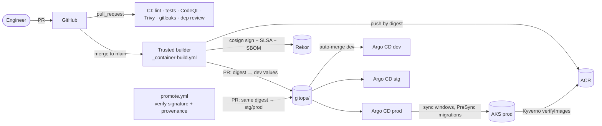

# GitOps and delivery

## Principles

1. **Build once, promote the digest.** Images are never rebuilt per environment; `promote.yml` copies the digest
   after re-verifying signature and provenance.
2. **Git is the only deploy API.** CI has no cluster credentials. Argo CD reconciles every 3 minutes and self-heals
   drift; manual `kubectl` changes are reverted.
3. **Approval is a PR review.** Dev merges automatically after checks; stg/prod need code-owner approval (and a
   change ticket for prod, enforced by the workflow). No separate CAB for standard changes.
4. **Policy travels with the change.** Kyverno and Azure Policy evaluate at admission; Conftest evaluates Terraform
   plans; failing policy blocks the merge or the sync.
5. **Progressive by environment.** Add-on chart versions are pinned per cluster folder; upgrades roll dev → stg → prod.

## Pipelines

| Workflow | Trigger | Purpose |
|---|---|---|
| `app-*.yml` | PR / main | Test, build, scan, sign, attest, deploy to dev |
| `_container-build.yml` | reusable | The trusted builder (SLSA build L3 pattern) |
| `promote.yml` | manual | Verified digest promotion dev → stg → prod |
| `terraform.yml` | PR / main | Plan + Conftest on PR; apply shared → dev → stg → prod with environment gates |
| `drift-detection.yml` | nightly | Read-only plan of every stack; opens an issue on drift |
| `k8s-validate.yml` | PR | Render all workloads, kubeconform, Kyverno tests and admission dry-run |
| `platform-tests.yml` | PR | Guardrail hooks, MCP server, Conftest, ShellCheck |
| `security-scans.yml` | PR / weekly | CodeQL, Gitleaks, dependency review, OpenSSF Scorecard |
| `docs.yml` | PR | Markdown lint, strict MkDocs build, ADR index check |
| `mirror-artifacts.yml` | change / weekly | Scan and import third-party images/charts into ACR |
| `ai-review.yml` | PR | Advisory Claude review with read-only tools |

## DORA instrumentation

Deployment frequency and lead time are derived from merged `deploy:` PRs (GitHub API); change failure rate from
PRs labelled `rollback` or incidents linked to a deploy; MTTR from incident records. See
[product metrics](../product/metrics.md).

## Rollback

Revert the GitOps PR (or run `promote.yml` with the previous digest). Argo CD syncs the previous ReplicaSet in
seconds; database migrations are forward-compatible by policy (expand/contract), so app rollback never needs a
schema rollback.
