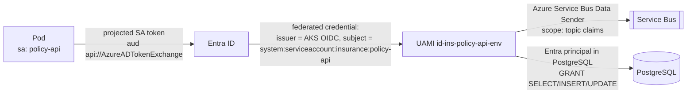

# Identity and access

Identity is the primary security perimeter. **No human or workload uses a long-lived credential** to reach Azure,
Kubernetes or data stores (ADR-0005). The single documented exception is EXC-0001 (Backstage database password).

## Human access

| Group (Entra) | Azure | AKS (Azure RBAC) | Argo CD | Elevation |
|---|---|---|---|---|
| `grp-platform-admins` | Contributor on platform RGs (eligible) | RBAC Cluster Admin | `role:admin` | PIM, 4 h, approval + justification |
| `grp-all-engineers` | Reader (non-prod), Monitoring Reader | RBAC Reader | `role:engineer` (read) | — |
| `grp-insurance-digital-engineers` | Reader on `rg-ins-*` | `view` in `insurance` ns (+ exec/port-forward in dev) | project `insurance` read; sync in dev/stg | — |
| `grp-insurance-dba` | — | — | — | PG Entra admin via PIM (break-glass only) |
| `grp-sre-oncall` | Contributor on prod RGs (eligible) | RBAC Writer (eligible) | admin (eligible) | PIM, incident ticket required |

Conditional Access: compliant device + phishing-resistant MFA for all admin portals and Grafana; sign-in risk
policies block risky sessions. Local accounts are disabled on AKS; `kubectl` uses `kubelogin` with Entra tokens.

## Workload identity

| Identity | Federated subject | Permissions (narrowest scope) |
|---|---|---|
| `id-ins-policy-api-<env>` | `insurance:policy-api` | SB Data Sender on topics `claims`, `policies`; PG role with DML on app tables |
| `id-ins-claims-worker-<env>` | `insurance:claims-worker` | SB Data Receiver on `claims/triage`; Sender on `claims`; PG update on triage columns |
| `id-ins-db-migrator-<env>` | `insurance:db-migrator` | Entra admin of that PostgreSQL server only (PreSync job) |
| `id-ins-keda-scaler-<env>` | `kube-system:keda-operator` | SB Data Owner on topic `claims` (queue-length reads) |
| `id-plat-otel-collector-<env>` | `observability:otel-collector` | Key Vault Secrets User (App Insights connection string) |
| `id-plat-kyverno-<env>` | `kyverno:kyverno-admission-controller` | AcrPull (signature verification) |
| `id-plat-argocd-repo-server-<env>` | `argocd:argocd-repo-server` | AcrPull (OCI Helm charts) |
| `id-<cluster>-kubelet` | n/a (kubelet) | AcrPull |

## CI/CD identity (GitHub OIDC)

| Identity | Trusted subject | Rights |
|---|---|---|
| `id-gh-tf-plan-<env>` | `repo:harborline/harborline-idp:pull_request`, `…:ref:refs/heads/main` | Reader on env + hub + mgmt; state blob lease |
| `id-gh-tf-apply-<env>` | `repo:harborline/harborline-idp:environment:<env>` | Contributor on env sub; **RBAC Administrator constrained by ABAC** to an allow-list of roles |
| `id-gh-acr-push` | main branch of platform + service repos | AcrPush on shared ACR |

The ABAC condition (`stacks/bootstrap/main.tf`) means a compromised apply pipeline cannot grant itself Owner or
User Access Administrator — only the specific data-plane roles workloads need.

## Kubernetes RBAC hygiene

- `automountServiceAccountToken: false` everywhere (Kyverno-enforced); no workload talks to the API server.
- Tenants cannot create Roles/RoleBindings (AppProject blacklist) and cannot bind `cluster-admin` (Kyverno).
- Wildcards in tenant Roles are denied (CIS 4.1.3).
