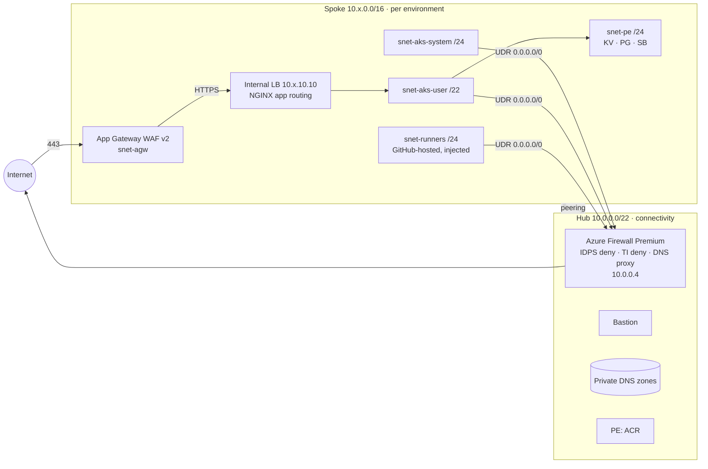

# Network architecture

## Topology

## IP address plan

| Range | Use |
|---|---|
| `10.0.0.0/22` | Hub: `AzureFirewallSubnet` /26, `AzureBastionSubnet` /26, `snet-shared-pe` /26, `GatewaySubnet` /25 |
| `10.10.0.0/16` | dev spoke |
| `10.20.0.0/16` | stg spoke |
| `10.30.0.0/16` | prod spoke |
| `192.168.0.0/16` | Pod overlay CIDR (Cilium) — not routable, reused per cluster |
| `172.16.0.0/16` | Kubernetes service CIDR — reused per cluster |

Spoke subnets (shown for dev): `snet-aks-system 10.10.0.0/24`, `snet-aks-user 10.10.4.0/22`,
`snet-agw 10.10.8.0/24`, `snet-pe 10.10.9.0/24`, `snet-ilb 10.10.10.0/24`, `snet-runners 10.10.11.0/24`.
With Azure CNI Overlay only nodes consume VNet addresses, so a /22 user subnet supports ~1,000 nodes.

## Traffic flows

| Flow | Path | Controls |
|---|---|---|
| North–south ingress | Internet → WAF public IP → internal LB → NGINX → pod | WAF DRS 2.1 + Bot Manager (Prevention), geo-allow CA/US, 600 req/min/IP, TLS 1.2+ (`AppGwSslPolicy20220101S`), end-to-end TLS, NSG on `snet-ilb` only from `snet-agw` |
| Egress | Node/pod → UDR → Firewall → Internet | FQDN allow-list (AKS FQDN tag, Azure Monitor, GitHub for Argo CD, Sigstore); IDPS + threat intel in Deny mode |
| PaaS access | Pod → private endpoint in `snet-pe` | Private DNS in hub; Kubernetes NetworkPolicy allows only the app's PE ports |
| East–west in cluster | Pod → pod | Default-deny NetworkPolicy per tenant; explicit allows rendered by the golden chart |
| Cross-spoke | Spoke → firewall → spoke | Denied by default; Backstage (prod) → AKS API servers is the only rule |
| Admin | Engineer → Bastion → private endpoints / `az aks command` | Entra ID + PIM, no SSH to nodes, no public API server |

## DNS

Spokes use the firewall as DNS server (DNS proxy), which forwards to Azure DNS in the hub where every
`privatelink.*` zone is linked. This keeps one authoritative set of private zones (ALZ pattern) and gives the
firewall FQDN visibility for network rules. On-premises resolution uses conditional forwarders to the firewall
through ExpressRoute (gateway subnet reserved).

## Why not…

- **Azure Front Door** in front of App Gateway: valuable for global audiences; Harborline serves Canada from one
  region with DR, so a regional WAF keeps latency and cost low (revisit with ADR if multi-region active-active).
- **Application Gateway for Containers**: attractive Gateway API model; AGW v2 + managed NGINX is GA-proven and keeps
  WAF policy ownership with Security. Tracked on the [roadmap](../product/roadmap.md).
