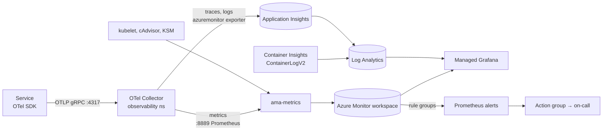

# Observability

**Standard:** OpenTelemetry for instrumentation, Azure Monitor as the backend (ADR-0009).

## Signals

| Signal | Source | Store | Retention |
|---|---|---|---|
| Traces | OTel SDK (FastAPI, psycopg, Service Bus spans) | Application Insights | 90 days |
| App logs | stdout JSON (+ OTel logs bridge) | Log Analytics (ContainerLogV2) / App Insights | 90 days (audit tables 2 y) |
| App metrics | OTel metrics → collector Prometheus exporter | Azure Monitor workspace | 18 months |
| Platform metrics | ama-metrics (kube-state-metrics, node exporter, cAdvisor) | Azure Monitor workspace | 18 months |
| Control-plane logs | AKS diagnostic settings | Log Analytics (resource-specific) | 90 d / 2 y |
| Network | Firewall + WAF + VNet flow logs | Log Analytics | 90 d / 2 y |

## Conventions

- Resource attributes: `service.name`, `service.namespace` (team), `service.version`, `deployment.environment.name`,
  `k8s.*` — set by the golden chart, enriched by the collector's `k8sattributes` processor.
- HTTP metrics use stable semantic conventions (`OTEL_SEMCONV_STABILITY_OPT_IN=http`):
  `http_server_request_duration_seconds` is the basis of every API SLO.
- Business metrics are prefixed `insurance.*` and documented with the service.
- PII never enters telemetry: apps mask before logging; the collector deletes auth headers, hashes `enduser.id`
  and redacts email/SIN/card patterns as defence in depth.

## Dashboards and alerts

| Asset | Location |
|---|---|
| Service golden signals (per service, SLO burn) | `platform/observability/dashboards/service-golden-signals.json` |
| Platform overview (nodes, Argo CD, Kyverno, chargeback) | `platform/observability/dashboards/platform-overview.json` |
| Insurance business KPIs | `platform/observability/dashboards/insurance-business-kpis.json` |
| Platform alerts (Prometheus) | `infra/terraform/modules/aks/alerts.tf` |
| SLO recording + burn-rate alerts | `infra/terraform/stacks/workload-insurance/slo.tf` |
| PaaS metric alerts | PostgreSQL / Service Bus modules |

Every alert carries a `runbook_url` annotation pointing to `docs/operations/runbooks/`.

## Known gaps and roadmap

- **Azure Monitor Private Link Scope (AMPLS)** is not yet enabled; ingestion uses Entra-authenticated public
  endpoints restricted by the firewall `AzureMonitor` service tag. Roadmap R2.
- **Tail-based sampling** needs a load-balancing collector tier; today sampling is head-based per environment
  (100% dev/stg, 20% prod, errors always kept by the SDK parent-based sampler).
- Grafana is reachable over the internet with Entra ID + Conditional Access (ADR-0009); private endpoint planned.
