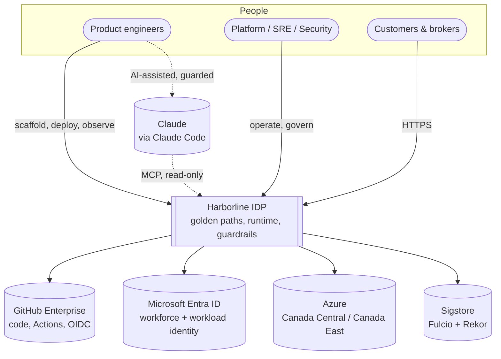
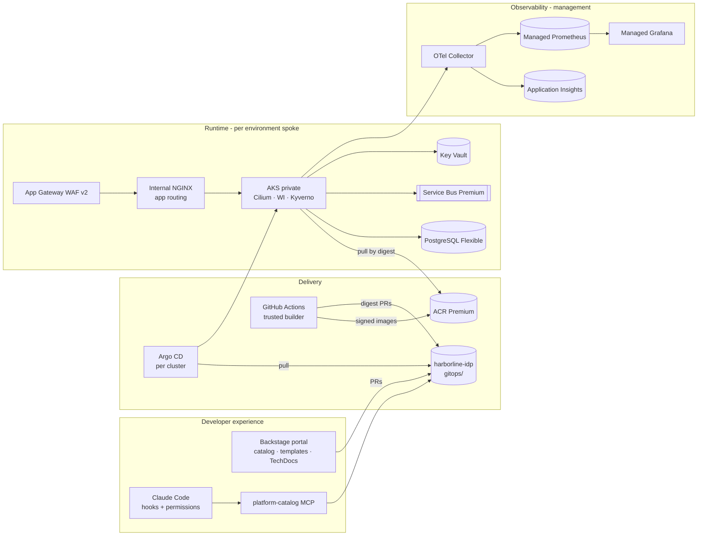
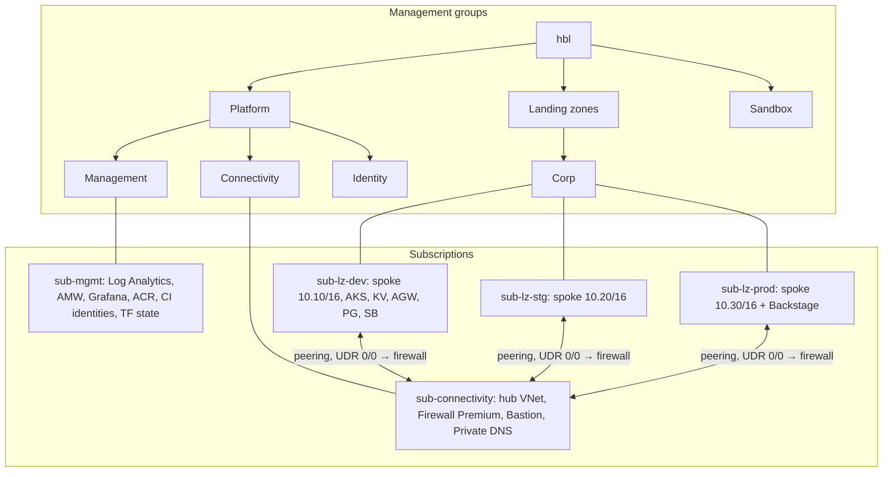
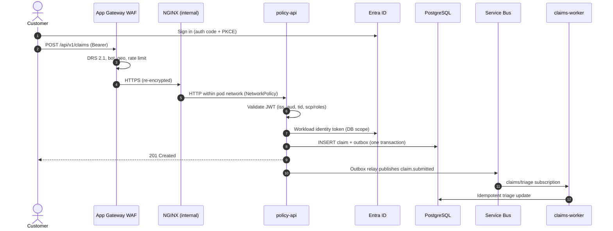

# Architecture overview

The Harborline IDP is a layered platform: an **Azure Landing Zone** foundation, a **runtime** layer of private AKS
clusters, a **delivery** layer (GitHub Actions + Argo CD), a **developer experience** layer (Backstage, templates,
Claude + MCP), and **cross-cutting** security, observability and governance. Each layer is owned by a team, versioned
in this repository and exposed to product teams as self-service capabilities.

## System context (C4 level 1)

## Containers (C4 level 2)

## Deployment topology

## Request path (customer quote)

## Key properties

| Property | How |
|---|---|
| No public data plane | Private endpoints for every PaaS service; private AKS API; only the WAF has a public IP |
| No long-lived secrets | Workload identity for pods, OIDC for CI, Entra auth for PostgreSQL and Service Bus |
| Everything as code | Terraform, Helm, Kustomize, policies, dashboards, alerts, SLOs, docs |
| Pull-based delivery | Argo CD in each cluster; CI never holds cluster credentials |
| Verifiable supply chain | Sigstore signatures + SLSA provenance verified at admission |
| Paved road | One chart, one pipeline, one portal; deviations require an exception record |

Rendered SVGs of every diagram (for slides and reviews) live in `docs/architecture/diagrams/` (`make diagrams`).

Deep dives: [Landing zone](landing-zone.md) · [Network](network.md) · [Identity](identity-and-access.md) ·
[AKS](aks-platform.md) · [Data & messaging](data-and-messaging.md) · [Observability](observability.md) ·
[GitOps & delivery](gitops-and-delivery.md) · [Well-Architected](well-architected.md)
