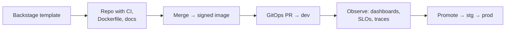

# The golden path

The golden path is the **supported, paved way** to build and run a service at Harborline. It is not mandatory to be
creative off it — but everything on it is pre-approved by Security, SRE and Architecture, so teams that stay on it
skip reviews, tickets and waiting.

## Requirements

Each requirement has an ID used by scorecards, the `platform-catalog` MCP server (`validate_service`) and reviews.

| ID | Requirement | Enforced by |
|---|---|---|
| GP-01 | Catalog entry with owner, system, lifecycle, tier and data classification | Backstage template; scorecard; MCP `validate_service` |
| GP-02 | Repository created from a template with CODEOWNERS and branch protection | `publish:github` settings in templates |
| GP-03 | Multi-stage container image, non-root runtime user, minimal base, no secrets | Trivy, Kyverno PSS restricted, review |
| GP-04 | Automated unit tests with ≥ 80% coverage on domain code; integration tests for adapters | `_python-ci.yml` coverage gate |
| GP-05 | `/healthz/live` (process) and `/healthz/ready` (dependencies) endpoints | Golden chart probes; Kyverno `require-resources-and-probes` |
| GP-06 | OpenTelemetry traces, metrics and logs via the collector | Golden chart OTel env; dashboards depend on it |
| GP-07 | Structured JSON logs without PII | Code review; collector redaction; Claude guard hook |
| GP-08 | Azure access only via workload identity (no secrets) | Chart + Conftest + Azure Policy |
| GP-09 | Deployed only through GitOps with the `golden-service` chart | AppProjects; Kyverno label policy |
| GP-10 | Images signed, attested and pinned by digest | `_container-build.yml`; Kyverno `verify-image-signatures`, `restrict-image-registries` |
| GP-11 | SLOs defined with burn-rate alerts (tier-0/1/2) | `stacks/workload-*/slo.tf`; scorecard |
| GP-12 | Runbook and dashboard linked from the catalog entity | Catalog annotations; scorecard |
| GP-13 | Threat model for tier-0/1 or restricted-data services, reviewed yearly | Security review gate; `/threat-model` command |

## What you get without asking

| Capability | Provided by |
|---|---|
| Namespace, quota, RBAC, network isolation | Tenant onboarding template |
| Build, test, scan, SBOM, sign, attest, deploy | Reusable workflows |
| Secure runtime defaults | `golden-service` chart |
| Identity to Azure services | Workload identity module |
| Database / messaging | `workload-*` Terraform stack modules |
| Dashboards, alerts, SLO tooling | Observability stack |
| Docs site | TechDocs from your repo |
| AI assistance with platform context | Claude Code + `platform-catalog` MCP |

## Leaving the path

You can — with an [exception](exceptions-process.md) that states the reason, the compensating controls and an end
date. Platform Engineering's job is to make exceptions unnecessary: every approved exception is reviewed as a
candidate feature for the path.
