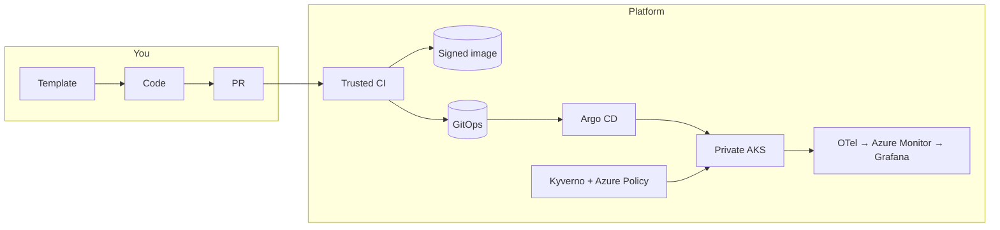

# Harborline Internal Developer Platform

The paved road for building, shipping and running services on Azure at Harborline Insurance.

| I want to… | Start here |
|---|---|
| Ship my first service | [Getting started](getting-started.md) |
| Understand the architecture | [Architecture overview](architecture/overview.md) |
| Know what "golden path" means for my service | [Golden path](governance/golden-path.md) |
| Deploy the platform into a new tenant | [Deployment guide](deployment-guide.md) |
| Respond to an alert | [Runbooks](operations/runbooks/index.md) |
| Check a security control | [Controls matrix](security/controls-matrix.md) |
| Use AI safely | [AI guardrails](ai/guardrails.md) |
| See why something was decided | [ADRs](adr/index.md) |

## Platform at a glance

**Standards:** Azure Landing Zone · Microsoft Well-Architected Framework · NIST CSF 2.0 · CIS AKS Benchmark ·
OWASP ASVS 5.0 · SLSA.

Questions: `#platform-help` on Teams, or open a *Platform request* issue in `harborline/harborline-idp`.
