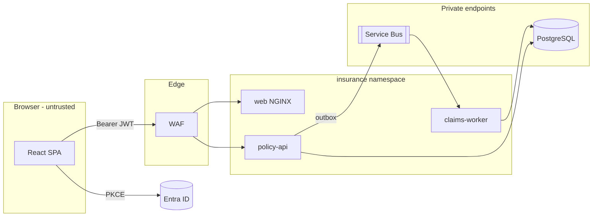

# Threat model — Harborline Policy Portal (reference app)

- **Assets:** policyholder PII (name, email, date of birth, province), claim narratives, premiums, policy state.
- **Classification:** restricted. **Tier:** 1 (customer-facing).
- **Actors:** customers/brokers (authenticated), underwriters/adjusters (app roles), anonymous internet, insiders.

| ID | Threat (STRIDE) | Control in code/config | ASVS 5.0 | L×I |
|---|---|---|---|---|
| A-01 | Forged or replayed tokens (S) | `auth.TokenValidator`: RS256 only, issuer, audience, tenant, exp/nbf with 60 s leeway, JWKS caching | V9, V10 | 2×5 |
| A-02 | Broken object-level authorisation / IDOR (E) | Every query filters by `created_by = principal.subject`; same 409/404 for missing vs not-owned | V8 | 3×5 |
| A-03 | Missing function-level authorisation (E) | `require(scopes, roles)` dependency on every route; tests in `test_auth.py` | V8 | 2×4 |
| A-04 | Mass assignment / unexpected fields (T) | pydantic `extra="forbid"`, frozen models, `Literal` enums | V2, V15 | 2×3 |
| A-05 | SQL injection (T) | Parameterised psycopg queries only; no string-built SQL; least-privilege DB roles | V1 | 1×5 |
| A-06 | XSS in SPA (T) | React escaping; strict CSP (`script-src 'self'`); no `dangerouslySetInnerHTML` | V3 | 2×4 |
| A-07 | PII in logs/traces/events (I) | `pii.mask` in JSON formatter; events without PII; collector redaction; validation errors never echo values | V14, V16 | 3×4 |
| A-08 | Verbose errors (I) | RFC 9457 problems; generic 500 with correlation id; no docs UI outside local | V16 | 2×2 |
| A-09 | Business logic abuse: bind expired/declined quote (T) | Status + expiry checked under `FOR UPDATE`; single bind per quote (unique constraint) | V2 | 2×4 |
| A-10 | Duplicate claim processing (T) | Deterministic message IDs, SB duplicate detection, idempotent inbox | V2 | 2×3 |
| A-11 | Poison message DoS (D) | Validation → dead-letter; max delivery 5; DLQ alert | V2 | 3×2 |
| A-12 | Request flooding (D) | WAF rate limit, 1 MB body limit at NGINX, statement timeout 5 s, HPA | V4 | 3×3 |
| A-13 | Insider reads production data (I) | No standing DB access; PIM + pgaudit; Entra-only auth | V8, V16 | 2×5 |
| A-14 | Unsafe config in prod (E) | `Settings.validate()` refuses auth bypass, passwords, non-TLS outside local | V13 | 1×5 |
| A-15 | Clickjacking / MIME sniffing (T) | `frame-ancestors 'none'`, `X-Content-Type-Options: nosniff` at app, NGINX and WAF | V3 | 1×3 |

## Abuse cases tested

- Token for another audience/tenant/issuer is rejected (`test_rejects_bad_claims`).
- HS256 algorithm confusion is rejected (`test_rejects_hs256_confusion`).
- Mass-assignment fields are rejected (`test_unknown_fields_rejected`).
- Script/SQL payloads in names fail validation (`test_names_are_constrained`).
- Other users cannot bind or read a quote/policy (integration test `test_quote_bind_claim_and_outbox`).

## Residual risks

- Fraud scoring rules are simple and deterministic; model-risk governance is required before ML-based triage.
- Customer email is stored in plaintext JSONB (encrypted at rest by the service). Column-level encryption with
  Key Vault keys is on the app backlog for prod data volumes beyond the reference scope.
