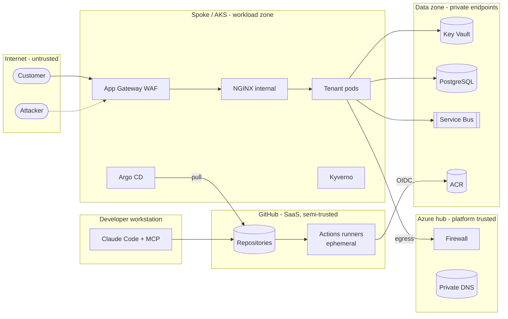

# Threat model — Harborline IDP (platform)

- **Method:** STRIDE per element on the data-flow diagram, likelihood × impact (1–5 each, risk ≥ 15 = release blocker)
- **Scope:** landing zone, AKS runtime, delivery pipeline, GitOps, portal, AI tooling. Application-level threats are in
  [threat-model-insurance-app.md](threat-model-insurance-app.md).
- **Review cadence:** quarterly and on any ADR that changes a trust boundary. Last review: 2026-11-16.

## Data-flow diagram and trust boundaries

## Threats and mitigations

| ID | Element | STRIDE | Threat | L | I | Risk | Mitigations (implemented) | Residual |
|---|---|---|---|---|---|---|---|---|
| P-01 | GitHub Actions | Spoofing / Elevation | Stolen cloud credentials from CI used to modify prod | 3 | 5 | 15 | OIDC only, no secrets; per-env identities; prod apply only from `environment:prod` with reviewers; ABAC-constrained RBAC delegation (`stacks/bootstrap`) | 6 |
| P-02 | Supply chain | Tampering | Malicious image or dependency deployed | 3 | 5 | 15 | Trusted builder; Trivy/CodeQL/dep-review; SBOM; Sigstore signature + SLSA provenance verified by Kyverno; digest pinning; ACR mirror with scan | 6 |
| P-03 | Registry | Tampering | Tag mutation / registry write by attacker | 2 | 5 | 10 | Digest deploys; AcrPush only for CI identity; admin user disabled; signature verification | 4 |
| P-04 | AKS API | Spoofing / Elevation | Remote access to Kubernetes API | 2 | 5 | 10 | Private cluster, no public FQDN; Entra + Azure RBAC; local accounts disabled; PIM for admin | 3 |
| P-05 | Tenant pod | Elevation | Container escape / privilege escalation | 2 | 5 | 10 | PSS restricted (Kyverno + Azure Policy); non-root, read-only rootfs, drop ALL, seccomp; AzureLinux; Defender runtime | 4 |
| P-06 | Tenant pod | Information disclosure | Lateral movement to other tenants or IMDS | 3 | 4 | 12 | Default-deny NetworkPolicy; IMDS excluded from egress; workload identity per SA; no API token mounted | 4 |
| P-07 | Egress | Information disclosure | Data exfiltration to the internet | 3 | 5 | 15 | Forced tunnelling; firewall FQDN allow-list; IDPS + TI deny; private endpoints; DNS via firewall | 6 |
| P-08 | WAF / ingress | Denial of service | L7 flood, bots | 4 | 3 | 12 | WAF rate limit + Bot Manager; autoscaling AGW/NGINX/HPA; Azure DDoS Network Protection on hub (ALZ) | 6 |
| P-09 | Argo CD | Tampering | Malicious manifest merged to `gitops/` | 2 | 5 | 10 | CODEOWNERS, 2 reviews, signed commits, AppProject restrictions, Kyverno admission | 4 |
| P-10 | Terraform state | Information disclosure | State reveals sensitive values | 2 | 4 | 8 | Entra-only storage, no shared keys, per-env containers, lease locking, versioning, no secrets in state except EXC-0001 | 4 |
| P-11 | Key Vault | Information disclosure | Secret read by wrong workload | 2 | 4 | 8 | RBAC per identity, private endpoint, audit logs to SIEM | 2 |
| P-12 | Backstage | Elevation | Template abuse creates privileged resources | 2 | 4 | 8 | Templates only open PRs; platform review; permission policy; GitHub App least scopes | 4 |
| P-13 | AI tooling | Tampering / Disclosure | Prompt injection makes an agent exfiltrate data or mutate infra | 3 | 4 | 12 | Deny rules + hooks block mutation/secret reads; MCP read-only, allow-listed; AI review read-only; data classification rules; audit log | 6 |
| P-14 | Logging | Repudiation | Admin actions not attributable | 2 | 3 | 6 | Activity logs, kube-audit-admin, Argo CD audit, PIM records, Claude audit hook → SIEM | 2 |
| P-15 | Sigstore dependency | Denial of service | Rekor/Fulcio outage blocks admission | 2 | 3 | 6 | Break-glass PolicyException procedure (time-boxed, runbook); existing pods unaffected | 4 |

## Top residual risks

1. **RA-0003** — etcd encrypted with platform keys, not CMK (KMS needs API Server VNet Integration). Owner: AKS SME, R2.
2. **RA-0004** — Azure Monitor ingestion via public endpoints (AMPLS pending). Owner: SRE, R2.
3. **EXC-0001** — Backstage database password authentication. Owner: Platform Product, expires 2027-05-31.
4. Single-region active runtime: regional outage relies on rebuild DR (RTO 4 h). Owner: SRE.
5. Dependency on GitHub availability for deploys (not for running workloads). Owner: DevSecOps.
